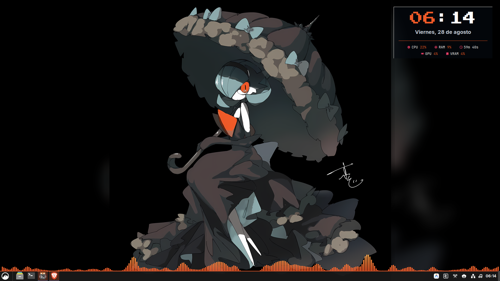
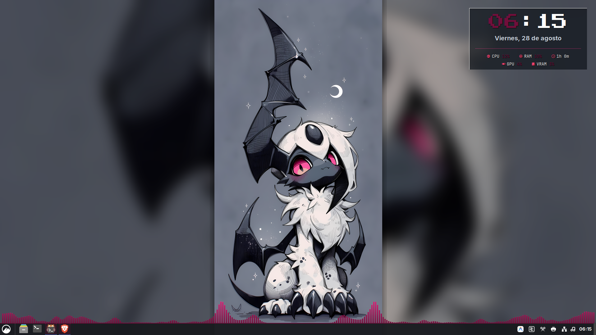
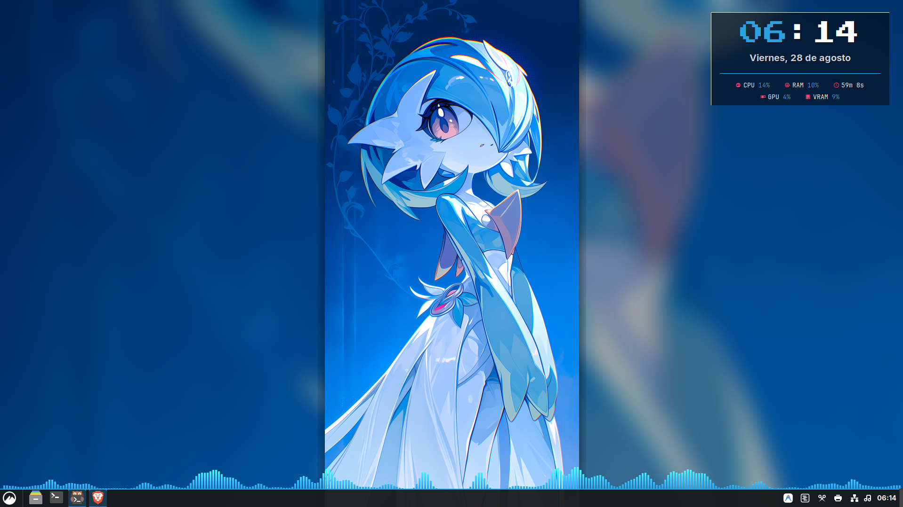
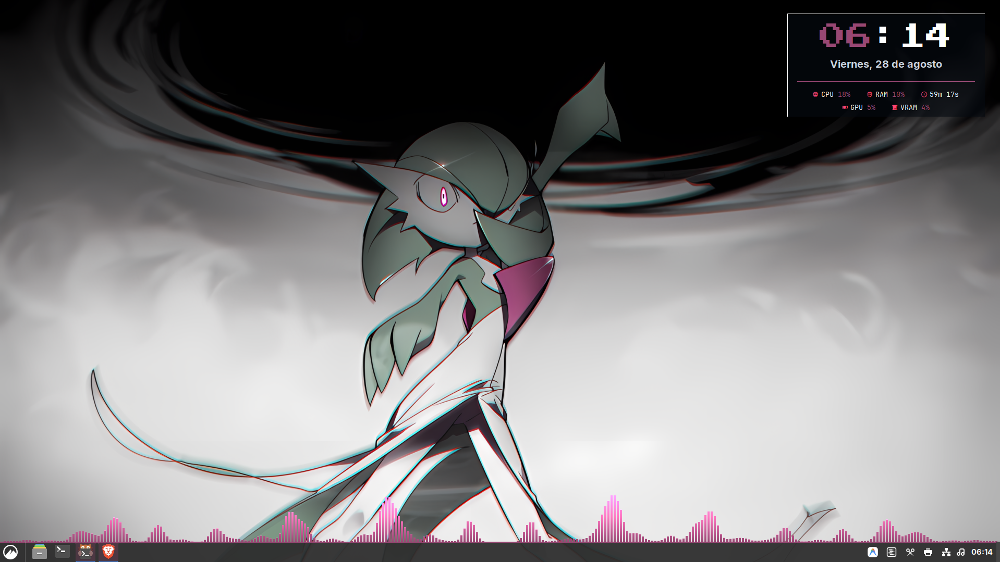
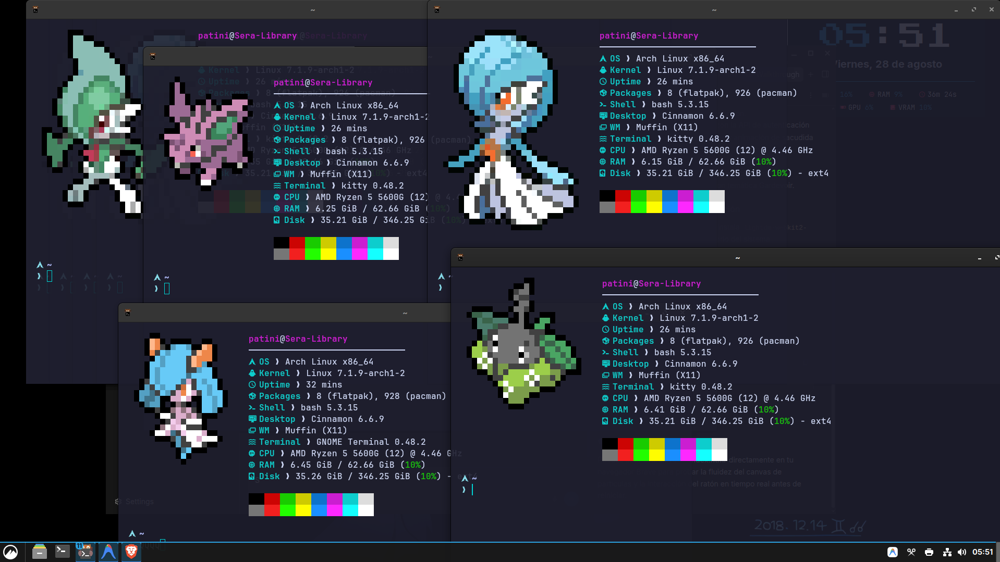

# 🌸 Gardevoir Dynamic Arch Setup

Un entorno de trabajo completo para **Arch Linux + Cinnamon**, optimizado para desarrollo, robótica (**ROS 2 Jazzy**) y control **100% por teclado**.

## Características Principales
* **Tema Dinámico Gardevoir:** La barra de tareas, bordes de Rofi y luces RGB (OpenRGB) se adaptan automáticamente a los colores de cada fondo de pantalla en 4K.
* **Flujo 100% Teclado y Modern CLI:**
  * `Win + Espacio` -> Rofi Spotlight
  * `Win + Tab` -> Buscador de Ventanas en Cualquier Monitor
  * `Win + X` -> Menú de Energía (Apagar/Reiniciar)
  * `Win + /` -> Panel Flotante de Atajos y Comandos de Terminal (`eza`, `bat`, `ripgrep`, `fd`, `yazi`, etc.)
  * `Win + Flechas` -> Smart Tile (Ventanas: ciclos 50% -> 33.3% -> 66.7%, columna central y cuadrantes)
  * `Win + Shift + C` -> Gardevoir Poké-Calc (Calculadora Glassmorphism Pokémon)
  * `Win + Shift + T` -> Gardevoir TimeDex (Reloj, Temporizador, Cronómetro, Alarmas y Clima)
  * `Win + J / K / N` -> Control Multimedia (Anterior, Play/Pausa, Siguiente)
  * `Win + }` -> Cambiar Idioma de Teclado (ES / EN con sonido Pokémon)
  * `Win + Enter` -> Terminal Kitty con Pokémon
* **Widgets e Integración Inteligente:**
  * **Reloj con Clima en Tiempo Real:** Conky y TimeDex integran el estado meteorológico por IP mediante Open-Meteo sin API key.
  * **Control Táctil de Ventanas:** Gestos multitáctiles con Touchégg (3 dedos para minimizar/maximizar y Alt+Tab; 4 dedos para escritorios).
  * **Inhibición Inteligente de Suspensión:** No apaga la pantalla mientras haya música sonando en PipeWire.
* **Herramientas Modernas de Terminal (CLI):**
  * `ls` / `ll` / `tree` -> `eza` (Iconos, colores, tamaños legibles y árbol)
  * `cat` -> `bat` (Resaltado de sintaxis, paginación y números de línea)
  * `rg` -> `ripgrep` (Búsqueda ultra rápida en archivos)
  * `fd` -> Alternativa moderna e instantánea a `find`
  * `fzf` -> Búsqueda difusa interactiva (`Ctrl+R`, `Ctrl+T`, `Alt+C`)
  * `yazi` (`y`) -> Explorador de archivos con previsualización 4K en terminal
  * `btop` -> Monitor interactivo de CPU, RAM, GPU NVIDIA y procesos
* **Audio Dinámico (GLava):** Visualizador de ondas en tiempo real sobre la barra de tareas.
* **Entorno Robótica (ROS 2 Jazzy):** Contenedor Ubuntu 24.04 con aceleración NVIDIA y RViz2.
* **Herramientas Rápidas:** Visor `Viewnior` (sprites Godot), `Zathura` (PDFs modo oscuro) y `Yazi` (explorador 4K).
* **Historial de Portapapeles:** `Win + V` abre CopyQ de forma estable (script `copyq-toggle.sh`).

## Instalación en una nueva máquina (Laptop / PC)
```bash
git clone git@github.com:Patini789/ARCH-Linux-config.git ~/dotfiles
cd ~/dotfiles
./install.sh
```

> El repo es privado. Necesitas acceso autenticado (SSH o token).
> Piezas externas que `install.sh` **no** instala (hacer manualmente):
> - Theme de web-greeter `gardevoir-shiny` en `/usr/share/web-greeter/themes`
> - Sonidos de Pokémon en `~/.local/share/sounds/pokemon/*.ogg | *.wav`
> - Theme de iconos `Papirus-Dark`

## Capturas











## Proyecto opcional: Gardevoir SoundDex

Reproductor Pokédex para YouTube Music en ventana-app de Brave, con arranque aleatorio y MPRIS. Instala con `bash extras/pokedex-player/install.sh`; después aparece al buscar **reproductor** en Rofi (**Win + Espacio**). La vista previa y la extensión local están en [`extras/pokedex-player/`](extras/pokedex-player/). `pokedex.css` queda como tema opcional para Pear Desktop/th-ch.
